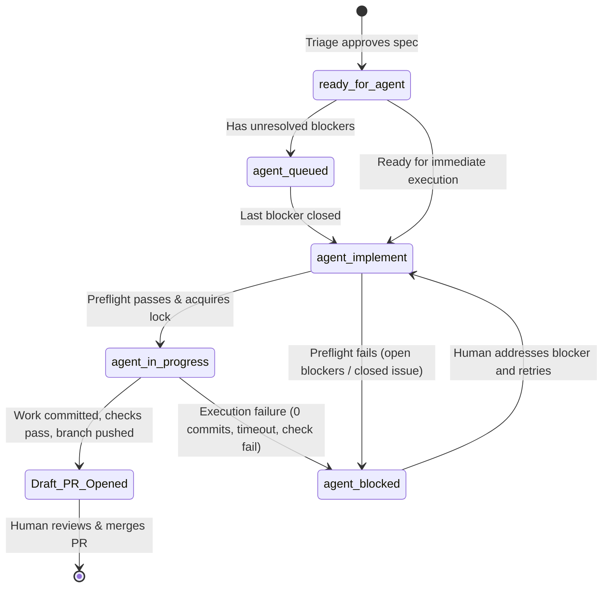

# State Machine & Label Lifecycle

The software factory operates as a deterministic, label-driven finite state machine. GitHub issue labels represent authorization, progress locks, and failure conditions.

---

## Canonical Labels

| Label | Applied By | Meaning & Function |
| :--- | :--- | :--- |
| `ready-for-agent` | Human (Triage) | Specification is complete and verified. Triage signal only; does **not** trigger a run. |
| `agent:implement` | Human or Auto-Promote | **The Trigger.** Initiates an immediate factory execution run via GitHub Actions. |
| `agent:queued` | Human (Author/Lead) | Backlog authorization. The factory automatically triggers this issue once all blockers close. |
| `agent:in-progress` | Factory Orchestrator | **Mutual Exclusion Lock.** An active runner is executing on this issue. Prevents duplicate runs. |
| `agent:blocked` | Factory Orchestrator | The run failed or was refused. Requires human review before retry. |

---

## State Transitions & Guarantees

### 1. Preflight Validation
Before spawning the agent, the orchestrator evaluates:
- **Issue state**: Must be `OPEN` and must not be a pull request.
- **Lock check**: If `agent:in-progress` is already present, abort immediately to prevent duplicate runs.
- **Dependency check**: Query native issue blockers (`dependencies/blocked_by`). If any blocking issue is `open`:
  - Swap `agent:implement` $\to$ `agent:blocked`.
  - Leave an issue comment identifying the blocking issues.
  - Abort execution without spawning the agent container.
- **Lock acquisition**: Atomically remove `agent:implement` and add `agent:in-progress`.

### 2. Auto-Promotion (`agent-promote-queued`)
When any issue closes with `state_reason: completed`:
1. Find all open issues bearing `agent:queued`.
2. Inspect each issue's `dependencies/blocked_by` list via the GitHub API.
3. If an issue has zero open blockers and does not carry `agent:in-progress`:
   - Remove `agent:queued`.
   - Add `agent:implement`.
   - Dispatch `agent-implement.yml` via `workflow_dispatch`.

### 3. Lock Release Guarantee
The `agent:in-progress` label is cleared in a post-execution step running under `if: always()`. Whether the run succeeds, fails, or cancels, the lock is freed to prevent permanent stalling.

### 4. Failure Consumption
A failed run never leaves `agent:implement` active. The trigger is consumed, `agent:blocked` is applied, and the failure details are posted as an issue comment. Retrying requires explicit re-application of `agent:implement`.
